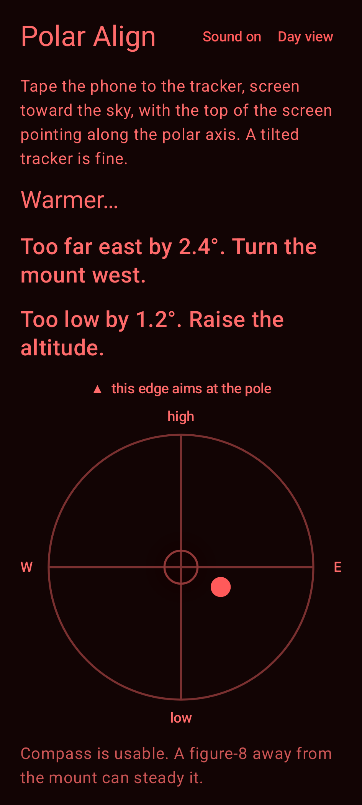
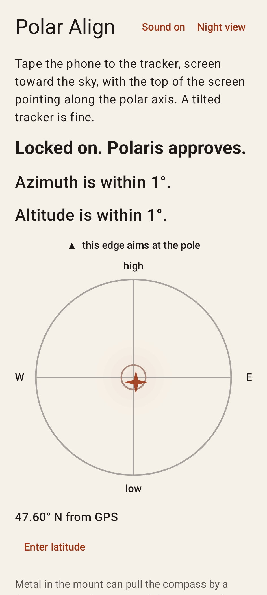

# Polar Align

Polar Align aims a star tracker at the north celestial pole. Tape the phone to the tracker, screen toward the sky, with the top of the screen along the polar axis. The app reads the compass and how the phone is tilted, then tells you which way to turn the mount.

The pole sits due north, at an angle above the horizon equal to your latitude. The mount counts as aligned when azimuth and altitude are both within 1°.

## Screenshots

Night view is for use beside a telescope. Day view is the same screen with a light background.

<p>
  
  
</p>

## How to use it

1. Put the phone on the tracker, screen up. The top edge of the screen should point along the polar axis. A tilted tracker is fine, as long as the left and right edges of the phone are level.
2. Allow location, or enter a northern latitude between 0 and 90. GPS also supplies magnetic declination, so the compass is corrected toward true north. Without a location fix, the compass can be off by several degrees.
3. Follow the azimuth and altitude lines. On the chart, the dot moves east or west and high or low. The mark at the top of the chart is the edge that should aim at the pole.
4. Switch to night view when you are outside. Turn sound on if you want tones that speed up as the error shrinks, plus a confirmation when the mount locks on. The phone also vibrates the same way.
5. If the compass warning appears, wave the phone in a figure-8 away from the mount, then set it back down. Metal in the mount can still pull the reading by a degree or two.

A southern latitude is rejected. This app only finds the north celestial pole.

The screen stays on while Polar Align is open.

## Requirements

- Android 14 (API 34) or newer
- A compass and an accelerometer. The app says so if the phone does not report them.

## Build

Open the project in Android Studio, or from the repo root:

```shell
./gradlew :app:assembleDebug
./gradlew :app:testDebugUnitTest
```

The debug APK is written to `app/build/outputs/apk/debug/`. The project uses JDK 17.
